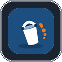
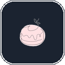
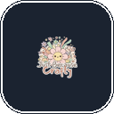
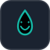
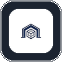
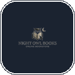
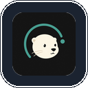

 

<a href="#about">About</a> &nbsp;·&nbsp; <a href="#tech-stack">Stack</a> &nbsp;·&nbsp; <a href="#featured-work">Featured</a> &nbsp;·&nbsp; <a href="#flyrank-works">FlyRank Works</a> &nbsp;·&nbsp; <a href="#yulee-web-studio">Yulee</a> &nbsp;·&nbsp; <a href="#projects-by-category">All projects</a> &nbsp;·&nbsp; <a href="#github-activity">Activity</a>

 

<h2>&nbsp;About</h2>

I'm a **Computer Science student specializing in Data Science** who builds *systems that earn trust*: ML models you can audit, AI agents that refuse to guess, and full-stack products for real Filipino problems.

- **Studying:** B.S. Computer Science, Data Science at **FEU Institute of Technology** (2023 - present). Dean's and President's Lister, **Dean's Gold** (2nd Term, S.Y. 2024-2025).
- **Experience:** Back-End AI Engineering Intern at **[FlyRank AI](https://flyrank.ai)**, Jul - Oct 2026 (completed). The capstones, backend work and ML research are collected in [FlyRank Works](#flyrank-works).
- **Founding:** **[Yulee](https://www.yulee.tech)**, a Modern Web Solutions studio for dental, dermatology, solar, real estate, law and craft brands.
- **Now:** finishing my undergraduate thesis, growing Yulee, and open to internships and entry-level roles in backend, AI and data.
- **Interested in:** decision-support ML, grounded LLM and RAG systems, civic tech, data products.
- **Credentials:** Anthropic, AWS, Docker and PMI certificates.
- **Member of:** ACM (FEU Tech chapter, since 2023) and Junior Philippine Computer Society (since 2024).
- **Based in:** Manila, Philippines.

<h2>&nbsp;Tech stack</h2>

 
 
 

 

<h2>&nbsp;Featured work</h2>

Deployed projects with public code come first. Open any card to use the live app.

<table width="100%">
<tr><td width="50%" valign="top"> <b><a href="https://harvester-risk-atlas.vercel.app"><b>Harvester Risk Atlas</b></a></b>
Ranks 29 wild medicinal plants of the Philippines by harvest priority, and shows how sure each rank is. Python · pandas · web app · EthnoHACK 2026
&ensp;</td><td width="50%" valign="top"> <b><a href="https://groundtruth-ph.vercel.app"><b>GroundTruth</b></a></b>
Checks 9,855 flood-control contracts (₱547.6B) against their claimed towns and ranks what to verify first. JavaScript · rule engine · LovHack S3
&ensp;</td></tr>
<tr><td width="50%" valign="top"> <b><a href="https://muni-flyrank.vercel.app"><b>Muni</b></a></b>
Grounded AI twin that answers only from verified cards, cites its sources, and refuses when evidence is missing. Next.js · Prisma · RAG · FlyRank capstone
&ensp;</td><td width="50%" valign="top"> <b><a href="https://rescutes.vercel.app"><b>ResCutes</b></a></b>
Animal-rescue coordination from street report to shelter intake, medical clearance and adoption. Next.js · Drizzle · Neon · Mapbox · AnimalHack 2026
&ensp;</td></tr>
<tr><td width="50%" valign="top"> <b><a href="https://agriruleph.vercel.app"><b>AgriRulePH</b></a></b>
Rule-based crop planning expert system: 30 crops, 158 IF-THEN rules, explainable rankings and what-if analytics. Django · PostgreSQL (Neon) · Vercel · CS0065
&ensp;</td><td width="50%" valign="top"> <b><a href="https://checkmydevice.vercel.app"><b>CheckMyDevice</b></a></b>
Nine guided hardware checks in one browser tab for buying, selling or repairing a device. Nothing is uploaded. React · Vite · Tailwind
&ensp;</td></tr>
<tr><td width="50%" valign="top"> <b><a href="https://gastosgo.vercel.app"><b>GastosGo</b></a></b>
Personal finance tracker for expenses, bills and goals in pesos. Used by nearly 50 people. Next.js · Auth.js · Drizzle · Neon
&ensp;</td><td width="50%" valign="top"> <b><a href="https://bantaylamok.vercel.app"><b>BantayLamok</b></a></b>
Mobile-first dengue-prevention app: inspect, review, act and follow up, with a research replay on Quezon City data. Next.js · Neon · Recharts
&ensp;</td></tr>
<tr><td width="50%" valign="top"> <b><a href="https://trakngbasura-app.vercel.app"><b>TrakNgBasura</b></a></b>
Community-sourced garbage-truck tracking with an honest live map and approaching alerts for barangay pilots. Expo · Next.js · Supabase · PostGIS
&ensp;</td><td width="50%" valign="top"> <b><a href="https://orderboard-gold.vercel.app"><b>OrderBoard</b></a></b>
Chat-to-kitchen tickets for home food sellers: menu link, PayMongo deposit, kitchen ticket, WhatsApp confirmation. Next.js · Drizzle · Neon
&ensp;</td></tr>
</table>

&nbsp; deployed, click to open &nbsp;&nbsp; &nbsp; public code &nbsp;&nbsp; &nbsp; private repository

<h2>&nbsp;FlyRank Works</h2>

Everything I built as a Back-End AI Engineering Intern at FlyRank AI (Jul - Oct 2026, completed), in one place.

<table width="100%">
<tr>
<td width="64" align="center" valign="middle"></td>
<td valign="middle"><a href="https://yuan-mariano-works.netlify.app/"><b>FlyRank Works Hub</b></a>&nbsp;&nbsp; 
One static site that publishes everything from my Back-End AI Engineering internship at FlyRank AI (completed October 2026): capstones, backend assignments, General AI Fluency and the machine-learning track. 
Source lives in a local Netlify project, not on GitHub. Each item below links to its live page and, where public, its code.</td>
</tr>
</table>

<table width="100%">
<tr>
<td width="50%" valign="top"><h3>&nbsp;Capstones</h3>
&nbsp;&nbsp;<a href="https://muni-flyrank.vercel.app"><b>Muni</b></a>&nbsp;&nbsp;&nbsp; Grounded personal agent with a Grounding Guard.  &nbsp;&nbsp;<a href="https://lens-flyrank.vercel.app"><b>Lens</b></a>&nbsp;&nbsp;&nbsp; Image relevance and auto-tagging that refuses the wrong image.  &nbsp;&nbsp;<a href="https://ledger-flyrank.vercel.app"><b>Ledger</b></a>&nbsp;&nbsp;&nbsp; Usage metering and billing with idempotent events and Stripe test checkout.  &nbsp;&nbsp;<a href="https://checkpoint-flyrank.vercel.app"><b>Checkpoint</b></a>&nbsp;&nbsp;&nbsp; Embeddable widgets with a hardened multi-tenant lead-capture boundary.  &nbsp;&nbsp;<a href="https://broadcast-flyrank.vercel.app"><b>Broadcast</b></a>&nbsp;&nbsp;&nbsp; Social media studio: one blog post becomes platform-sized crops and captions.
</td>
<td width="50%" valign="top"><h3>&nbsp;Backend AI Engineering</h3>
&nbsp;&nbsp;<a href="https://yuan-flyrank-crud-api.netlify.app"><b>A1 · CRUD API</b></a>&nbsp;&nbsp;&nbsp; In-memory task API with Swagger and filters.  &nbsp;&nbsp;<a href="https://yuan-flyrank-sqlite-crud.netlify.app"><b>A2 · Database</b></a>&nbsp;&nbsp;&nbsp; The same API persisted on SQLite.  &nbsp;&nbsp;<a href="https://yuan-flyrank-containerize.netlify.app"><b>A3 · Containers</b></a>&nbsp;&nbsp;&nbsp; Postgres-backed API, one-command Docker Compose stack.  &nbsp;&nbsp;<a href="https://yuan-flyrank-auth-api.netlify.app"><b>A4 · Auth</b></a>&nbsp;&nbsp;&nbsp; Supabase JWT verification and a reusable route guard.  &nbsp;&nbsp;<a href="https://yuan-flyrank-bg-job.netlify.app"><b>Background Job</b></a>&nbsp;&nbsp;&nbsp; Accept-fast queue: worker, retries, idempotency, alerts.  &nbsp;&nbsp;<a href="https://yuan-flyrank-scraper.netlify.app"><b>Polite Scraper</b></a>&nbsp;&nbsp;&nbsp; robots.txt, rate limits and a clean corpus for RAG.  &nbsp;&nbsp;<a href="https://yuan-flyrank-pdf-reports.netlify.app"><b>PDF Reports</b></a>&nbsp;&nbsp;&nbsp; SQL aggregation rendered to PDF as a background job.
</td>
</tr>
<tr>
<td width="50%" valign="top"><h3>&nbsp;General AI Fluency</h3>
&nbsp;&nbsp;<b>Eight weeks, one public page each</b>  <a href="https://yuan-mariano-works.netlify.app/weeks/w1/"><b>W1</b></a>&nbsp;&nbsp;Prove and map <a href="https://yuan-mariano-works.netlify.app/weeks/w2/"><b>W2</b></a>&nbsp;&nbsp;Frame and prompt <a href="https://yuan-mariano-works.netlify.app/weeks/w3/"><b>W3</b></a>&nbsp;&nbsp;Identity and judgment <a href="https://yuan-mariano-works.netlify.app/weeks/w4/"><b>W4</b></a>&nbsp;&nbsp;Ship and systems <a href="https://yuan-mariano-works.netlify.app/weeks/w5/"><b>W5</b></a>&nbsp;&nbsp;Agent and domain <a href="https://yuan-mariano-works.netlify.app/weeks/w6/"><b>W6</b></a>&nbsp;&nbsp;Feature and critique <a href="https://yuan-mariano-works.netlify.app/weeks/w7/"><b>W7</b></a>&nbsp;&nbsp;Harden and flag <a href="https://yuan-mariano-works.netlify.app/weeks/w8/"><b>W8</b></a>&nbsp;&nbsp;Tell and keep building  Prompting, identity, shipping, agents and critique. Every assignment has its own output page.
</td>
<td width="50%" valign="top"><h3>&nbsp;Machine Learning</h3>
&nbsp;&nbsp;<a href="https://yuan-mariano-works.netlify.app/ml/paper/"><b>Research Paper</b></a>&nbsp;&nbsp;&ensp; Ranking content for refresh review from observable search signals.  &nbsp;&nbsp;<a href="https://yuan-mariano-works.netlify.app/ml/ml-08-modeling/"><b>Modeling Desk</b></a>&nbsp;&nbsp; Random forest selected: Precision@50 0.74 vs 0.24 baseline.  &nbsp;&nbsp;<a href="https://yuan-mariano-works.netlify.app/ml/"><b>All ML Desks</b></a>&nbsp;&nbsp; Ten desks from starter notebooks to the shipped paper and story.
</td>
</tr>
<tr>
<td colspan="2" valign="top"><h3>&nbsp;Portfolio built for FlyRank</h3>
&nbsp;&nbsp;<a href="https://yuan-mariano.vercel.app"><b>Portfolio</b></a>&nbsp;&nbsp;&ensp; Capstone shelf, case studies and the Tuklas RAG assistant. Tailored to the FlyRank review path.
</td>
</tr>
</table>

<h2>&nbsp;Yulee Web Studio</h2>

Websites and systems I design and ship through Yulee. Live studio and client work is listed first; the industry builds are concept sites that show the craft for each vertical, not paid client engagements.

<table width="100%">
<tr><td width="25%" valign="top"> <a href="https://www.yulee.tech"><b>Yulee Agency Site</b></a>
Studio site and client showcase
&ensp;</td><td width="25%" valign="top"> <a href="https://patisserie-ph.vercel.app"><b>Patisserie</b></a>
Custom-cake atelier, Malabon
&ensp;</td><td width="25%" valign="top"> <a href="https://just-because-crafty.vercel.app"><b>Just Because Crafty</b></a>
Handmade wire flowers store
&ensp;</td><td width="25%" valign="top"> <a href="https://solgen-ph.vercel.app"><b>SolGen</b></a>
Solar installer concept
&ensp;</td></tr>
<tr><td width="25%" valign="top"> <a href="https://solar-nation-philippines.vercel.app"><b>Solar Nation PH</b></a>
Solar company concept
&ensp;</td><td width="25%" valign="top"> <a href="https://vantage-cruz-law-partners.vercel.app"><b>Vantage &amp; Cruz</b></a>
Boutique law firm concept
&ensp;</td><td width="25%" valign="top"> <a href="https://altavista-residences.vercel.app"><b>Altavista Residences</b></a>
Real estate concept
&ensp;</td><td width="25%" valign="top"> <a href="https://smilewellness-dental-ph.vercel.app"><b>SmileWellness Dental</b></a>
Dental clinic concept
&ensp;</td></tr>
<tr><td width="25%" valign="top"> <a href="https://lumina-dental-atelier.vercel.app"><b>Lumina Dental Atelier</b></a>
Dental atelier concept
&ensp;</td><td width="25%" valign="top"> <a href="https://luminare-dermatology.vercel.app"><b>Luminare Dermatology</b></a>
Dermatology clinic concept
&ensp;</td><td width="25%" valign="top"> <a href="https://lumiere-medical-aesthetics.vercel.app"><b>Lumi&egrave;re Aesthetics</b></a>
Medical aesthetics concept
&ensp;</td><td width="25%" valign="top"> <b>Yulee HQ</b>
Internal studio dashboard
</td></tr>
</table>

<h2>&nbsp;Projects by category</h2>

Each list is ordered the same way: deployed with public code, then deployed with a private repository, then everything else.

<table width="100%">
<tr><td width="50%" valign="top"><h3>&nbsp;Data Science</h3>
&nbsp;&nbsp;<a href="https://harvester-risk-atlas.vercel.app"><b>Harvester Risk Atlas</b></a>&nbsp;&nbsp;&ensp; Ranks 29 wild medicinal plants by harvest priority with uncertainty shown. Python · pandas  &nbsp;&nbsp;<a href="https://groundtruth-ph.vercel.app"><b>GroundTruth</b></a>&nbsp;&nbsp;&ensp; Triage for 9,855 flood-control contracts: pin-versus-town checks and a ranked verify queue. JavaScript · rule engine  &nbsp;&nbsp;<b>FrostHub</b>&nbsp;&nbsp; Forecasting and stock-optimization system for a frozen-meat wholesaler. PHP · MySQL  &nbsp;&nbsp;<b>Customer Segmentation Study</b>&nbsp;&nbsp; k-means segmentation with customer-lifetime-value analysis and export (CS0032). Python · k-means
</td><td width="50%" valign="top"><h3>&nbsp;AI and Intelligent Systems</h3>
&nbsp;&nbsp;<a href="https://agriruleph.vercel.app"><b>AgriRulePH</b></a>&nbsp;&nbsp;&ensp; Rule-based crop planning expert system: 30 crops, 158 IF-THEN rules, ranked picks with explanation traces and what-if analytics. Django · PostgreSQL (Neon) · Vercel  &nbsp;&nbsp;<a href="https://yuan-mariano.vercel.app"><b>Tuklas Assistant</b></a>&nbsp;&nbsp;&ensp; Grounded RAG chat on my portfolio: answers only from verified knowledge cards, with citations and honest refusals. Groq · retrieval · Vercel Functions  &nbsp;&nbsp;<a href="https://github.com/yuan05-afk/gemini-ai-co-drawing"><b>Gemini Co-Drawing</b></a>&nbsp;&nbsp; Co-drawing canvas that edits images with a text-to-image model, built in Google AI Studio. React · Gemini API
</td></tr>
<tr><td width="50%" valign="top"><h3>&nbsp;Civic Tech and Public Health</h3>
&nbsp;&nbsp;<a href="https://rescutes.vercel.app"><b>ResCutes</b></a>&nbsp;&nbsp;&ensp; Animal-rescue coordination from street report to adoption, with shelter routing. Next.js · Drizzle · Mapbox  &nbsp;&nbsp;<a href="https://bantaylamok.vercel.app"><b>BantayLamok</b></a>&nbsp;&nbsp;&ensp; Mobile-first dengue-prevention app: inspect, review, act and follow up, with a research replay. Next.js · Neon  &nbsp;&nbsp;<a href="https://trakngbasura-app.vercel.app"><b>TrakNgBasura</b></a>&nbsp;&nbsp;&ensp; Community-sourced garbage-truck tracking with an honest live map for barangay pilots. Expo · Next.js · Supabase
</td><td width="50%" valign="top"><h3>&nbsp;Web Apps and Products</h3>
&nbsp;&nbsp;<a href="https://checkmydevice.vercel.app"><b>CheckMyDevice</b></a>&nbsp;&nbsp;&ensp; Nine in-browser hardware checks for buying, selling or repairing a device. React · Vite  &nbsp;&nbsp;<a href="https://orderboard-gold.vercel.app"><b>OrderBoard</b></a>&nbsp;&nbsp;&ensp; Chat-to-kitchen tickets for home food sellers, with PayMongo deposits. Next.js · Drizzle · Neon  &nbsp;&nbsp;<a href="https://gastosgo.vercel.app"><b>GastosGo</b></a>&nbsp;&nbsp;&ensp; Personal finance tracker in pesos: expenses, bills and goals. Next.js · Auth.js · Neon  &nbsp;&nbsp;<a href="https://aeternum-flow.vercel.app"><b>Aeternum Flow</b></a>&nbsp;&nbsp;&ensp; Personal productivity app on Neon Auth and Postgres. React · Vite · Neon  &nbsp;&nbsp;<b>HANAP Client Finder</b>&nbsp;&nbsp; Internal dashboard that finds small businesses without websites and tracks outreach. Next.js · Drizzle · Places API
</td></tr>
<tr><td width="50%" valign="top"><h3>&nbsp;Education and Community</h3>
&nbsp;&nbsp;<a href="https://journalism-app-jade.vercel.app"><b>JournQuest</b></a>&nbsp;&nbsp;&ensp; Campus press studio that coaches student journalists with rule-based feedback. Next.js  &nbsp;&nbsp;<a href="https://verdictify-app.vercel.app"><b>Verdictify</b></a>&nbsp;&nbsp;&ensp; Study-reviewer hub for FEU Tech coursework and TOPCIT. HTML · JavaScript  &nbsp;&nbsp;<a href="https://info-sec-finals-reviewer.vercel.app"><b>InfoSec Finals Reviewer</b></a>&nbsp;&nbsp;&ensp; Interactive reviewer for Information Assurance and Security. HTML · JavaScript  &nbsp;&nbsp;<a href="https://anyssa-reviewer.vercel.app"><b>Anyssa Reviewer</b></a>&nbsp;&nbsp;&ensp; Grade 7 Math and Science site with guided lessons and mastery exams. Next.js  &nbsp;&nbsp;<b>UniHubConnect</b>&nbsp;&nbsp; Anonymous 1-on-1 chat for Philippine college students with queue-based matching. React · Express · WebSocket
</td><td width="50%" valign="top"><h3>&nbsp;Languages and Systems</h3>
&nbsp;&nbsp;<a href="https://shopscript-ecommerce.vercel.app"><b>ShopScript</b></a>&nbsp;&nbsp;&ensp; Mini e-commerce language with a full lexer-to-executor pipeline, running in the browser. React · TypeScript · Vite  &nbsp;&nbsp;<a href="https://github.com/yuan05-afk/online-bookstore"><b>Online Bookstore</b></a>&nbsp;&nbsp; Bookstore management system, later migrated to Supabase. PHP · MySQL  &nbsp;&nbsp;<b>Quotter</b>&nbsp;&nbsp; Privacy-first Windows dashboard for AI developer-tool usage, with local history and forecasts. Tauri · Rust · React · SQLite
</td></tr>
<tr><td width="50%" valign="top"><h3>&nbsp;Automation and Tools</h3>
&nbsp;&nbsp;<a href="https://github.com/yuan05-afk/google-sheets-automation"><b>Google Sheets Automation</b></a>&nbsp;&nbsp; Scheduled, OAuth2-secured download of a specific sheet to CSV or Excel. Python · Google API  &nbsp;&nbsp;<a href="https://github.com/yuan05-afk/2d-platformer-game"><b>2D Platformer</b></a>&nbsp;&nbsp; Browser platformer built and iterated in Google AI Studio. React · TypeScript  &nbsp;&nbsp;<b>MicroTask</b>&nbsp;&nbsp; Portable Windows macro recorder and auto clicker. No installer, no network. Python · PyInstaller  &nbsp;&nbsp;<b>Canvas Command Center</b>&nbsp;&nbsp; Chrome extension that turns FEU Canvas into a student dashboard. Manifest V3 · React
</td><td width="50%" valign="top"><h3>&nbsp;Community and Personal</h3>
&nbsp;&nbsp;<b>CS EXPO 2026</b>&nbsp;&nbsp; Event website and judging system for the FEU Tech CS Department expo. TypeScript · CS-EXPO-DEVS org  &nbsp;&nbsp;<b>5th Anniversary Site</b>&nbsp;&nbsp; Click-through interactive anniversary site, a personal gift project. React · Vite
</td></tr>
</table>

&nbsp; deployed, click to open &nbsp;&nbsp; &nbsp; public code &nbsp;&nbsp; &nbsp; private repository

<h2>&nbsp;GitHub activity</h2>

 

**Let's build something solid.** Open to internships, capstone collaboration and backend / AI work. 
*Built to matter: a website or system should earn trust in seconds and make the next step obvious.*

